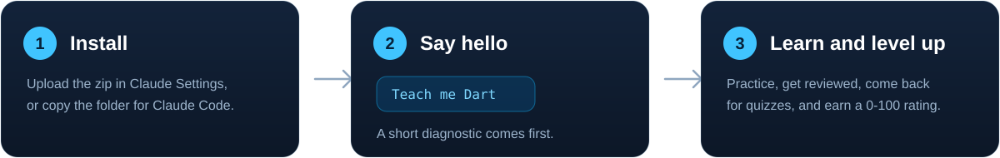
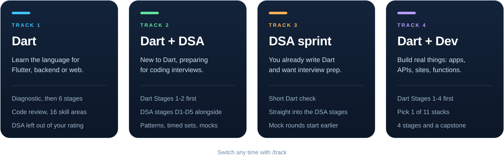
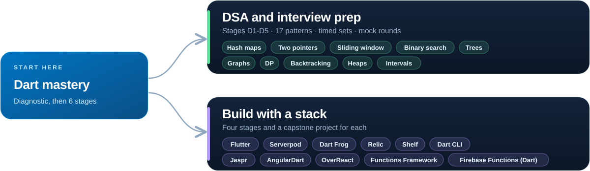

<div align="center">



<br>

[](https://github.com/priyanshusingh-in/claude-dart-mastery-tutor/releases/latest/download/dart-mastery-tutor.zip)
[](https://github.com/priyanshusingh-in/claude-dart-mastery-tutor/releases/latest)
[](LICENSE)
[](https://docs.claude.com/en/docs/agents-and-tools/agent-skills/overview)

### Your personal Dart tutor, code reviewer, interview coach and stack mentor, inside Claude.

[How it works](#how-it-works) &nbsp;·&nbsp;
[Install](#install) &nbsp;·&nbsp;
[Choose your path](#choose-your-path) &nbsp;·&nbsp;
[Reference](#reference) &nbsp;·&nbsp;
[Contributing](#contributing)

</div>

<br>

|  **Learn**  |  **Practice**  |  **Level up**  |
|:--|:--|:--|
| Starts with a diagnostic, so you begin where you actually are.<br><br>Teaches Dart 3 from scratch to mastery, linking the exact dart.dev page for every topic. | Reviews your Dart like a strict senior engineer.<br><br>Trains DSA by pattern, in Dart, and guides real projects with Flutter, Serverpod, Dart Frog, Jaspr and more. | A 0-100 rating across 16 skill areas, earned from evidence and never given.<br><br>Spaced repetition and mock interviews, including AI-assisted rounds. |

<br>

## How it works



<br>

<div align="center">

</div>

The tutor asks one question at a time and waits for your answer. It would rather ask than tell.

> [!NOTE]
> **Your progress travels with you.** Claude doesn't remember between chats on its own. At the end of each session the tutor prints a **Learner Card**. Save it (or run `/card` any time) and paste it at the start of your next chat to pick up exactly where you left off. If your Claude plan has Projects or memory, the card can live there.

<br>

## Install

| Claude apps (web and desktop) | Claude Code |
|:--|:--|
| 1. Download [`dart-mastery-tutor.zip`](https://github.com/priyanshusingh-in/claude-dart-mastery-tutor/releases/latest/download/dart-mastery-tutor.zip).<br>2. In Claude, open **Settings** and find **Skills** (it may sit under **Capabilities**).<br>3. Upload the zip and switch the skill on. | 1. Clone this repo.<br>2. Copy the `dart-mastery-tutor` folder into `~/.claude/skills/` for all projects, or into `.claude/skills/` for one project.<br>3. Run `/dart-mastery-tutor` or just say "Teach me Dart". |

<details>
<summary><b>Claude Code install commands</b></summary>
<br>

macOS / Linux / Git Bash:

```bash
git clone https://github.com/priyanshusingh-in/claude-dart-mastery-tutor.git
mkdir -p ~/.claude/skills
cp -r claude-dart-mastery-tutor/dart-mastery-tutor ~/.claude/skills/
```

Windows PowerShell:

```powershell
git clone https://github.com/priyanshusingh-in/claude-dart-mastery-tutor.git
New-Item -ItemType Directory -Force "$HOME\.claude\skills" | Out-Null
Copy-Item -Recurse .\claude-dart-mastery-tutor\dart-mastery-tutor "$HOME\.claude\skills\"
```

</details>

> [!TIP]
> Skills must be available on your Claude plan. If you don't see the option, check Anthropic's [Agent Skills docs](https://docs.claude.com/en/docs/agents-and-tools/agent-skills/overview).

Then start a new chat and say **"Teach me Dart"** (or **"Start my Dart tutor"**). It runs a short diagnostic, proposes a track, and builds your weekly roadmap. Paste Dart code at any time and it switches to code review.

<br>

## Choose your path

On day one the tutor asks about your goal and proposes a track. Switch any time with `/track`.



<br>

Dart mastery comes first for everyone who needs it. After that you can branch into interview prep or build with a stack, and add DSA alongside a stack. The tutor teaches one primary stack at a time.



DSA concepts apply in any language, but every template, tool and pitfall the tutor teaches is Dart. Not sure which stack to pick? Run `/stack` for one recommendation and a backup.

<br>

## Reference

Everything below is collapsed so the page stays easy to scan. Open what you need.

<details>
<summary><b>Commands</b> &nbsp;(21)</summary>
<br>

Type `/help` in a session for the short list.

**Learn**

| Command | What it does |
|---|---|
| `/roadmap` | Build or adjust your weekly roadmap: concepts, practice, milestones, progress checks. |
| `/explain <topic or text>` | Section-by-section plain-language explanation with an example, then 2 questions. |
| `/socratic <concept>` | Starts from a real-world example and guides you with one question at a time. |
| `/feynman <topic>` | You explain it back, the tutor finds the gaps and re-teaches only what you missed. |
| `/sprint <N days> <skill>` | Daily plan: one concept, one example, a 20-minute exercise, a common mistake, a success criterion. Mini-project every 3 days. |

**Practice and check**

| Command | What it does |
|---|---|
| `/review` | Strict senior review of the Dart code you paste. Pasting code with no message does the same. |
| `/gaps <topic>` | 10 questions from basic to advanced, then a report on what you know and what to study next. |
| `/test <level> <topic>` | Adaptive test with scenarios and "explain why" questions, ending in a score and revision plan. |
| `/flashcards <topic>` | Flashcards, comparisons and misconception checks, added to your review queue. |
| `/hint` | The smallest useful nudge. On DSA problems it climbs a hint ladder: constraint, data structure, pattern, steps in words. |
| `/solution` | Full solution, only after a real attempt. |

**DSA and interviews**

| Command | What it does |
|---|---|
| `/dsa` | Continue the DSA track: next pattern, problem set, timed set or re-solve that is due. |
| `/pattern <name>` | Learn one pattern: recognition, brute force, the idea, a Dart template, a problem ladder, teach-back. |
| `/problem [pattern \| easy \| medium \| hard]` | One problem, solved with the framework. No solution until you've really tried. |
| `/drill [patterns]` | Rapid-fire pattern recognition: 8 short statements, name the pattern, idea and complexity. |
| `/mock <dsa \| lld \| system-design \| ai-assisted>` | Mock interview round with a scorecard. |

**Build and progress**

| Command | What it does |
|---|---|
| `/track` | Show or switch your track: Dart, Dart + DSA, DSA sprint, or Dart + Dev with a stack. |
| `/stack [goal]` | Not sure which framework? Get one recommendation and a backup, with honest maturity notes. |
| `/build` | Continue your stack track: next lesson, feature or capstone step. You build first, then review. |
| `/card` | Print your Learner Card to save and reuse. |
| `/help` | List the commands. |

</details>

<details>
<summary><b>Dart curriculum</b> &nbsp;(6 stages)</summary>
<br>

Each stage ends with a small project and a `/gaps` check before you move on.

| Stage | Focus | Ends with |
|---|---|---|
| 1. Foundations | Variables, types, control flow, functions, collections, null safety basics | A small interactive CLI app |
| 2. Core language | Classes, mixins, enums, extensions, generics, errors, the Iterable API | A domain model with tests |
| 3. Modern Dart 3 | Records, patterns, sealed classes, class modifiers, extension types, soundness | A parser using sealed classes and pattern matching |
| 4. Async and concurrency | Event loop, Futures, Streams, isolates | A concurrent fetcher with timeouts and retries |
| 5. Professional Dart | pub, tooling, linting, `package:test`, compile targets, interop | A published-quality package |
| 6. Mastery | Reading SDK source, API design, profiling | A non-trivial end-to-end project |

</details>

<details>
<summary><b>DSA track</b> &nbsp;(5 stages, 17 patterns)</summary>
<br>

| Stage | Focus |
|---|---|
| D1 Foundations | Big-O, arrays and strings, hash maps, two pointers, sliding window, prefix sums, stacks and queues, binary search |
| D2 Structures | Recursion, linked lists, trees, tries, heaps and top-K, intervals |
| D3 Graphs and search | BFS/DFS and grids, topological sort, union-find, shortest paths, backtracking, greedy |
| D4 DP and advanced | 1D/2D and string DP, knapsack-style DP, monotonic stack, bit manipulation |
| D5 Interview mastery | Mixed timed sets, mock rounds, AI-assisted rounds, weak-pattern repair |

Each stage ends with a gate: the four-step ladder on at least 3 patterns and a timed mixed set. For every problem you must **recognize** the pattern, **explain** the approach, **implement** it in Dart, and **solve a variation**. The tutor tracks all four per pattern on your Learner Card, and patterns and problems come back for a from-scratch re-solve on Day 1, 3, 7, 14 and 30.

Dart-specific traps are taught when they first bite: `removeAt(0)` is O(n), `%` vs `remainder` with negatives, 64-bit `int` on native vs 53-bit on web, `List.filled` aliasing in 2D grids, unstable `List.sort`, and more.

</details>

<details>
<summary><b>Development stacks</b> &nbsp;(11)</summary>
<br>

Pick one after Dart Stage 4. Every stack follows the same four stages: **S1** setup and fundamentals, **S2** core features, **S3** data, state and testing, **S4** ship it. Each ends with a capstone and a separate **Stack rating** on your Learner Card.

| Stack | Best for | Capstone |
|---|---|---|
| **Flutter** | Mobile, desktop and web apps | An app with remote data, local persistence, error states and tests |
| **Serverpod** | Flutter apps with an all-Dart backend (typed client, ORM, auth, realtime) | A Flutter app with sign-in, a database-backed feature and live updates |
| **Dart Frog** | Small, fast REST APIs with file-based routing | A REST API with auth middleware, tests and a deployed container |
| **Relic** | A modern, strongly typed HTTP server with WebSockets | A REST + WebSocket service ported from Shelf |
| **Shelf** | Understanding handlers and middleware under every Dart server | A small API with logging and auth middleware |
| **Functions Framework** | Serverless HTTP and event functions on Google Cloud (via Cloud Run) | One HTTP and one event-driven function, deployed |
| **Cloud Functions for Firebase (Dart)** | Dart functions inside a Firebase project | A Flutter app backed by an HTTPS Dart function and Firestore |
| **Jaspr** | Websites in Dart: static, server-rendered or client-side | A content site or an SSR app with a backend |
| **AngularDart** | Maintaining existing AngularDart apps | A routed app with a service layer and component tests |
| **OverReact** | Typed React components in Dart, for React teams | A small app with Redux state |
| **Dart CLI** | Command-line tools and scripts | A tested, compiled command-line tool |

The tutor checks the current docs before teaching a stack and is upfront about maturity. For example, Cloud Functions for Firebase in Dart is still experimental, Functions Framework is community-supported and deploys to Cloud Run, and AngularDart is community-maintained.

</details>

<details>
<summary><b>Ratings and spaced repetition</b></summary>
<br>

Each of the 16 areas is scored 0-100 from evidence only, in small steps (usually ±2-8 per session). The overall rating maps to a level:

| Overall | Level |
|---|---|
| < 20 | Novice |
| 20-39 | Apprentice |
| 40-59 | Practitioner |
| 60-74 | Advanced |
| 75-89 | Expert |
| 90+ | Master |

Master means you can explain *why* Dart behaves as it does, write idiomatic production-quality code, and teach the concept back clearly. Areas without evidence stay "not assessed" rather than guessed.

Your **track decides what counts**. DSA and stack ratings are kept separate from the overall Dart rating, so you're never penalised for skipping them.

**Spaced repetition:** concepts come back as quick retrieval quizzes on Day 1, 3, 7, 14 and 30. On DSA tracks, patterns and problems come back as from-scratch re-solves. A failed review resets to Day 1.

</details>

<details>
<summary><b>The learning loop</b></summary>
<br>

1. **Warm-up:** a short no-notes quiz on review items due today.
2. **Main block:** the next lesson, in whichever mode fits (explain, Socratic, Feynman).
3. **Practice:** an exercise or problem you write and paste back.
4. **Wrap-up:** a 2-line summary, rating changes with reasons, an updated Learner Card, and what's next.

</details>

<details>
<summary><b>Interview track</b></summary>
<br>

- Three levels of AI use enforced during practice: **no AI**, **AI as tutor**, **AI as reviewer**.
- AI-assisted rounds: you get unfamiliar buggy Dart code and are graded on how you navigate it, plan, verify and judge AI output.
- `/mock` rounds for DSA, low-level design, system design and AI-assisted, each ending in a scorecard.

</details>

<details>
<summary><b>Repository layout</b></summary>
<br>

```text
claude-dart-mastery-tutor/
├── dart-mastery-tutor/           # the skill itself (this folder is what Claude loads)
│   ├── SKILL.md                  # tutor behaviour, tracks, commands, code review, spaced repetition
│   ├── LICENSE
│   └── references/
│       ├── learner-card.md       # rating system and Learner Card template
│       ├── roadmap.md            # staged curriculum and ecosystem branches
│       ├── dsa-track.md          # DSA stages, pattern catalog, framework, hint ladder, Dart templates
│       ├── development-tracks.md # stack chooser, curriculum and capstone per stack
│       └── interview-track.md    # AI-assisted interviews, levels of AI use, mock rounds
├── assets/                       # README banner, diagrams and demo
├── .github/                      # issue and PR templates, CODEOWNERS
├── CONTRIBUTING.md
├── LICENSE
└── README.md
```

</details>

<br>

## Contributing

Found a wrong Dart fact, an outdated feature, or a command that behaves badly? Please [open an issue](https://github.com/priyanshusingh-in/claude-dart-mastery-tutor/issues/new/choose). Pull requests are welcome too: fork the repo, change the files under `dart-mastery-tutor/`, and open a PR describing what you changed and why. Because Dart and its frameworks move quickly, please link the relevant official docs in your PR.

See [CONTRIBUTING.md](CONTRIBUTING.md) for the full guide. All changes to `main` are reviewed and merged by the maintainer.

**Sources:** [dart.dev/language](https://dart.dev/language) · [dart.dev/learn](https://dart.dev/learn) · [Dart cheatsheet](https://dart.dev/resources/dart-cheatsheet) · [Effective Dart](https://dart.dev/effective-dart) · [TheAlgorithms/dart](https://github.com/TheAlgorithms/dart)

<br>

<div align="center">

**MIT licensed** · Made by [Priyanshu Singh](https://github.com/priyanshusingh-in) · If this helps you learn Dart, a ⭐ is appreciated

<sub>Unofficial community project, not affiliated with or endorsed by Google or Anthropic. Dart and the Dart logo are trademarks of Google LLC.</sub>

</div>
